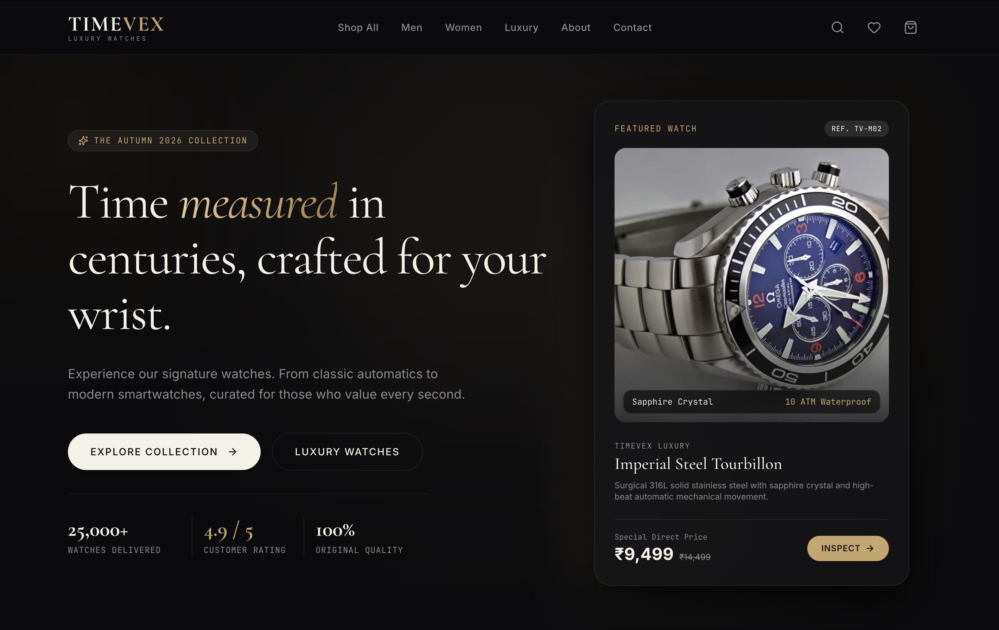
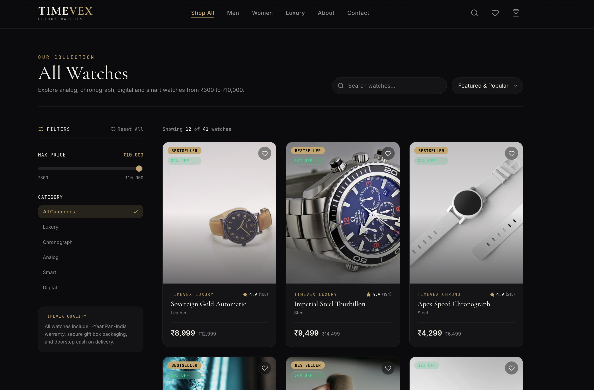
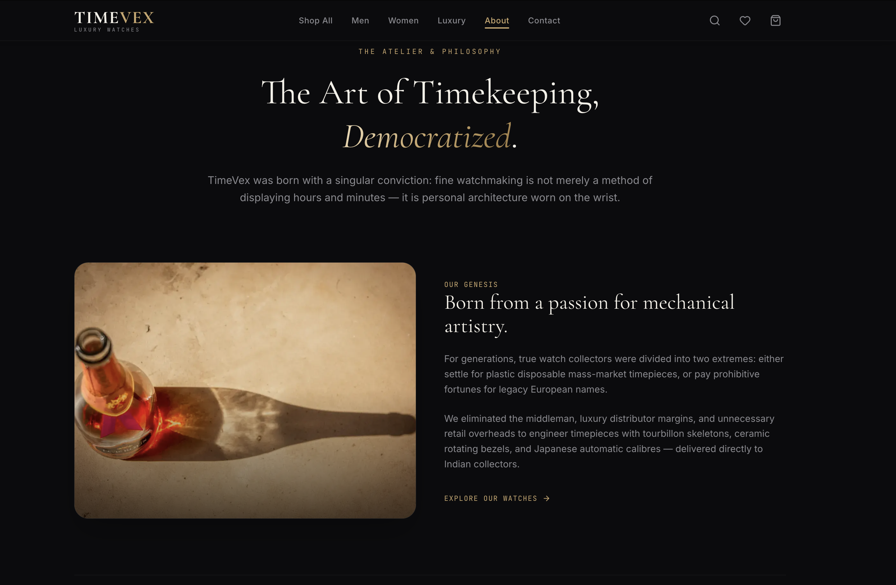
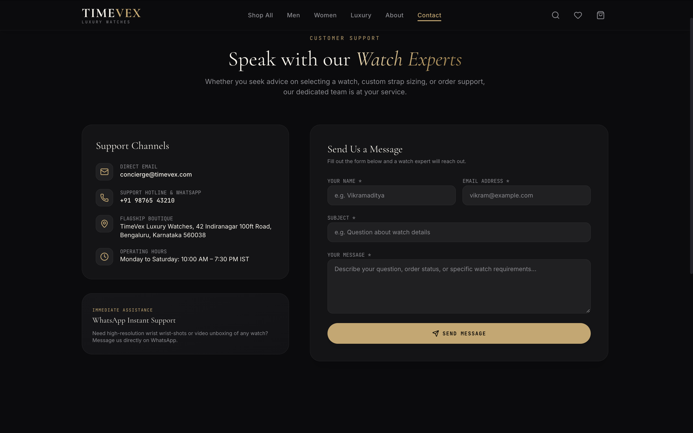

# TimeVex

A modern watch store website for men and women. Watches from Rs 300 to Rs 10,000.

## Live Demo

**Website:** [https://timevex-luxury-watches.vercel.app/](https://timevex-luxury-watches.vercel.app/)

**GitHub:** [https://github.com/imhasim/TIMEVEX-LUXURY-WATCHES](https://github.com/imhasim/TIMEVEX-LUXURY-WATCHES)

## Screenshots

### Home Page


### Shop Page


### About Page


### Contact Page


## Features

- Separate Men and Women sections
- Filters: Gender, Category and Max Price
- Search and sort (price, newest, popular)
- Product page with image gallery and specs
- Cart and Wishlist (saved in your browser)
- Coupon codes and checkout (demo only)
- About page and Contact page with a message form
- Fully responsive dark premium design
- Smooth animations

## Tech Stack

| Part | Technology |
|---|---|
| Framework | Next.js (App Router) |
| Language | TypeScript |
| Styling | Tailwind CSS |
| Animation | Framer Motion |
| State | Zustand |
| Forms | React Hook Form + Zod |
| Deploy | Vercel |

## Getting Started

```bash
# 1. Clone the project
git clone https://github.com/imhasim/TIMEVEX-LUXURY-WATCHES.git
cd TIMEVEX-LUXURY-WATCHES

# 2. Install packages
npm install

# 3. Start the development server
npm run dev
```

Open [http://localhost:3000](http://localhost:3000) in your browser.

To build for production:

```bash
npm run build
npm start
```

## Project Structure

```
TIMEVEX-LUXURY-WATCHES/
├─ app/            # Pages (Home, Shop, Product, Cart, Checkout...)
├─ components/     # Reusable UI parts
├─ data/           # Product data (products.ts)
├─ store/          # Cart and wishlist state
├─ lib/            # Helpers and form rules
└─ public/         # Images and screenshots
```

## Important Note

This is a **frontend-only** project. There is no backend or database.

- Product data is stored in `data/products.ts`.
- Cart and wishlist are saved in the browser (localStorage).
- Payments and orders are for demo only. No real payment is taken.

## Deployment

This project is deployed on [Vercel](https://vercel.com). Every push to the main branch updates the live website.

## License

MIT License

## Author

Made by [imhasim](https://github.com/imhasim)